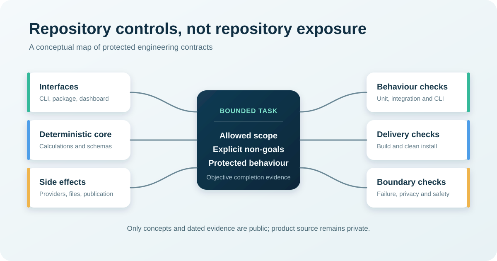

# Case Study: Stabilising an AI-Assisted Python Research Application

## Boundary

This is an engineering process case study. It does not evaluate investment
performance, promote a trading signal or provide financial advice. Product
source code is not included.

## Project overview

OpenTrendIQ Lite 1.0.0 is a local-first Python research application with a
command-line interface, deterministic indicators, structured research runs,
historical backtests, bounded explanation providers and a read-only local
dashboard.

Coding agents, primarily Codex, assisted extensively with development. The
central challenge was not generating more code. It was allowing a growing,
multi-module repository to change without silently breaking existing
contracts.

## Engineering risk

A plausible change in one area could affect:

- command names, options, exit codes or package entry points;
- deterministic calculation behaviour;
- offline test substitutes and external-provider boundaries;
- schema, manifest and file-publication rules;
- optional local and hosted explanation adapters;
- packaged dashboard assets and read-only routes; or
- research-only restrictions that exclude orders, brokers and accounts.

Broad requests could solve the visible task while changing unrelated defaults,
error behaviour or compatibility.

## Bounded phase development

Work was divided into narrow phases. Each phase identified:

- the intended behaviour;
- the permitted scope;
- explicit non-goals;
- interfaces and defaults that must remain unchanged;
- required verification commands; and
- objective acceptance evidence.

Passing the checks ended the phase; it did not grant permission to redesign
adjacent modules.

## Automated verification

Tests and packaging checks were treated as the acceptance source of truth.
Verification covered unit and integration behaviour, CLI contracts, offline
provider substitutes, local end-to-end flows, packaged web assets, build output
and clean-wheel execution.

The CI configuration exercises the offline suite on Windows and Ubuntu with
Python 3.11 and 3.12. Optional-provider tests use controlled substitutes rather
than live market or model-provider calls.

On 18 July 2026, a new local verification produced 693 passing tests, two
environment-related skips, one dependency deprecation warning, successful
wheel and source-distribution builds, and a successful clean-wheel CLI smoke
test. The latest master CI run checked for the same current baseline was also
successful.

## Explicit failure behaviour

Inputs, schemas, provider configuration and output files use bounded
validation. Invalid or incomplete inputs are rejected rather than silently
converted into plausible research results. A selected explanation provider is
not silently replaced by another provider when it fails.

Failure behaviour is part of the contract. A generated change is not accepted
merely because its happy path appears to work.

## Reproducible and atomic outputs

Research runs publish structured artefacts through a staging process. A
complete validated run becomes visible together. Failed staging output is
removed without replacing an earlier successful run.

Package checks create a wheel and source distribution, then test the installed
wheel outside the development checkout. This makes packaging assumptions and
file-system side effects visible.

## Constrained explanation providers

Explanation providers receive bounded structured summaries, not unrestricted
repository or account context. Provider selection, endpoints, accepted output
and fallback behaviour are explicit. Local Ollama is supported, while OpenAI is
optional in a separate bounded adapter path.

## Documentation as infrastructure

Project status, acceptance decisions, release notes, CLI help, package version
and CI commands describe the same stable scope. Deferred capabilities remain
visible rather than being presented as complete.

This lets a human or coding agent answer:

1. What is implemented now?
2. What must remain unchanged?
3. What has deliberately been deferred?
4. Which evidence decides whether a task is complete?

## Transferable lessons

- Repository instructions are strongest when paired with executable checks.
- Small tasks still need explicit non-goals and protected behaviour.
- Test evidence is stronger than a persuasive generated explanation.
- Installation and packaging should be tested outside the source checkout.
- Failure behaviour, side effects and provider selection need acceptance
  criteria.
- Documentation drift becomes an engineering defect when agents use that
  documentation to plan later work.

## Client relevance

The same approach can help a Python repository that grew quickly with AI
assistance but now has unclear commands, fragile tests, inconsistent project
instructions or difficult handover. A sensible first engagement diagnoses the
highest-leverage workflow and defines evidence before proposing a larger
implementation.
