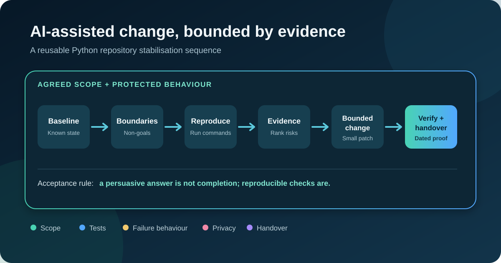
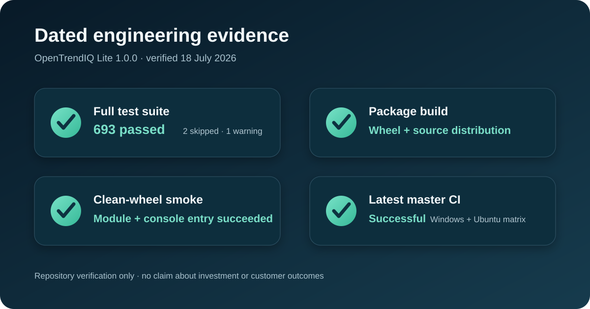

# AI-Assisted Python Repository Stabilisation

A sanitised engineering case study about keeping a growing Python repository
testable, reviewable and safe to continue developing with coding agents.

The case study is based on OpenTrendIQ Lite 1.0.0. It focuses on repository
controls, bounded implementation phases, automated verification and handover.
It does not publish product source code, assess investment performance or
provide financial advice.

## What is demonstrated

- narrow task scopes with explicit non-goals;
- protected interfaces and safety boundaries;
- repeatable installation, test and build commands;
- unit, integration, CLI and packaging checks;
- clean-wheel verification outside the development checkout;
- explicit failure behaviour and atomic output publication; and
- evidence-backed handover instead of prompt-based confidence.

## Verified evidence

The following results were reproduced from a clean local checkout on
18 July 2026:

| Check | Result |
| --- | --- |
| Package version | 1.0.0 |
| Full test suite | 693 passed, 2 skipped, 1 warning |
| Package build | Wheel and source distribution built successfully |
| Clean-wheel smoke test | Module and console help commands succeeded |
| Latest master CI checked | Successful |

The two skips were caused by unavailable Windows symlink support. The warning
was a dependency deprecation warning. Counts are dated evidence and should be
refreshed after the product repository changes.

## Read the case study

- [Case study](CASE_STUDY.md)
- [Reusable method](METHOD.md)
- [Evidence and commands](EVIDENCE.md)
- [Fictional phase specification](SAMPLE_PHASE_SPEC.md)
- [Fictional audit report](SAMPLE_AUDIT_REPORT.md)
- [Fixed-scope service](SERVICE.md)
- [Privacy and scope boundaries](PRIVACY_AND_SCOPE.md)

## Fixed-scope founding offer

The first three accepted case-study clients can book an
AI-Assisted Python Repository Stabilisation Audit for **AUD 149**, subject to a
written fit and scope check. The audit covers one Python repository, one primary
development environment and up to three core workflows.

Before sharing repository access, read the [service boundaries](SERVICE.md) and
send answers to these questions:

1. Which repeated development failure costs the most time or confidence?
2. Can the repository currently be installed and tested from written commands?
3. What result would make the audit useful enough to act on within 14 days?

Contact:

- [LinkedIn profile](https://www.linkedin.com/in/chen-songquan-0a5246423/)
- [LinkedIn service page](https://www.linkedin.com/services/page/a28237345922783843/)

## Experimental repository health inventory

A zero-dependency, read-only Python inventory tool is proposed in the
[repository health documentation](docs/REPO_HEALTH_CHECK.md), with
[dated OSS candidacy notes](docs/OSS_READINESS_2026-10-21.md).
It detects basic maintenance files but does not execute project code or
certify code quality, security, or Codex for Open Source eligibility.

## Publication and licence status

This repository is **already public** on GitHub. The
[publication checklist](PUBLICATION_CHECKLIST.md) is a historical, unfinished
review checklist, not proof that public visibility or formal release was
authorised. The default branch had no licence file on 21 October 2026.
A draft PR proposes MIT licensing strictly for four new utility-related files:
see [licensing scope](LICENSING_SCOPE.md) and [tools/LICENSE](tools/LICENSE).
The case study, diagrams, sample material and other historical files are not
covered by this MIT grant. No general release or PR merge is authorised.
Product source code from the private OpenTrendIQ Lite repository is not included.
